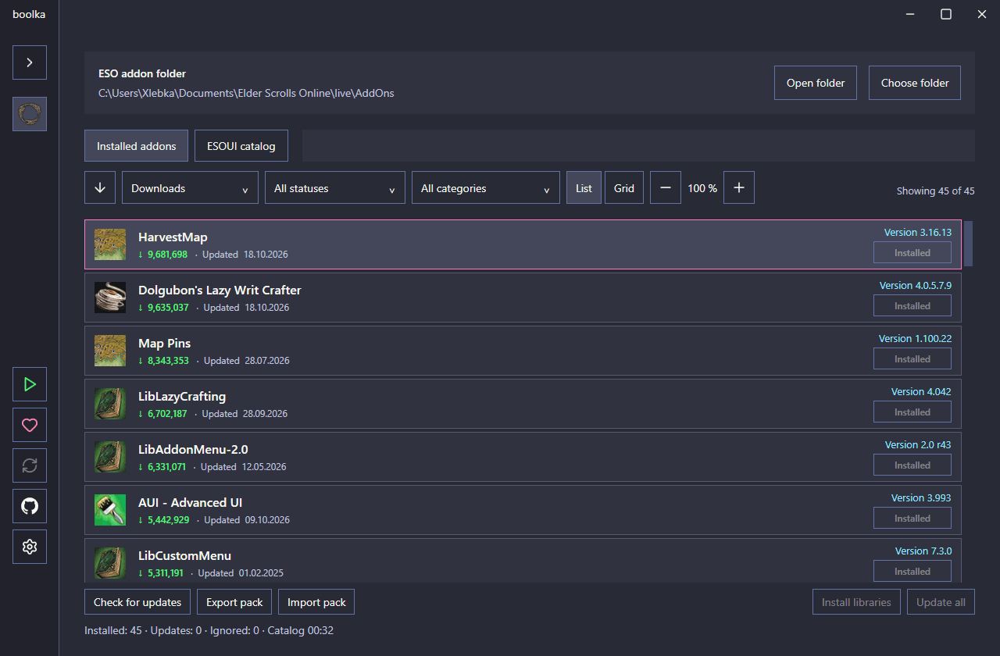

# boolka

[Русский](README.md) | **English**

An addon manager for The Elder Scrolls Online on Windows.

## GIF

## Installation

1. Download the **Windows x64 ZIP** from the [latest release](https://github.com/Xlebka3003/boolka/releases/latest).
2. Extract the entire archive and run `boolka.exe`.
3. Select your `Documents\Elder Scrolls Online\live\AddOns` folder.

Close ESO before installing or updating addons.

## License

[PolyForm Noncommercial License 1.0.0](LICENSE).

Copyright (c) 2026 Xlebka.

[Third-party notices](THIRD_PARTY_NOTICES.txt) · [Image sources](IMAGE_SOURCES.md)

## Support development

[Boosty — Xlebka](https://boosty.to/xlebka/donate)
