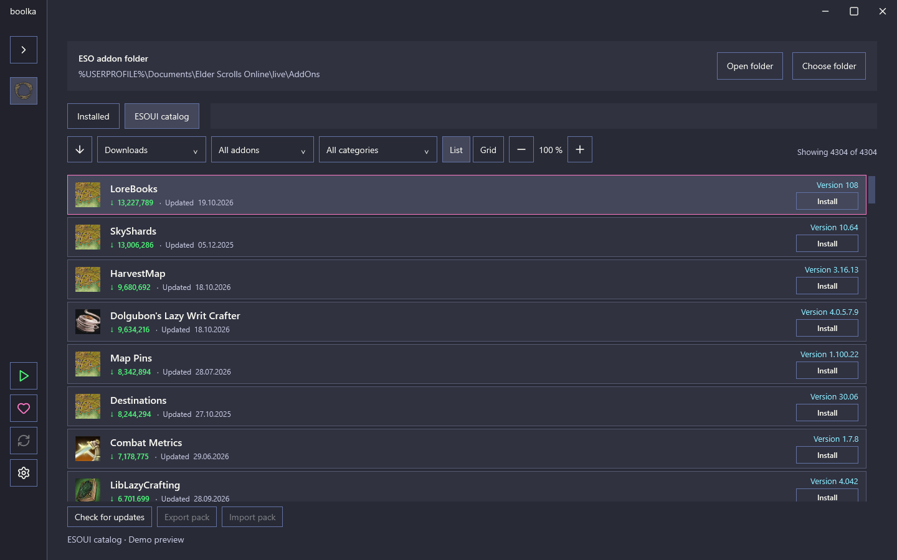
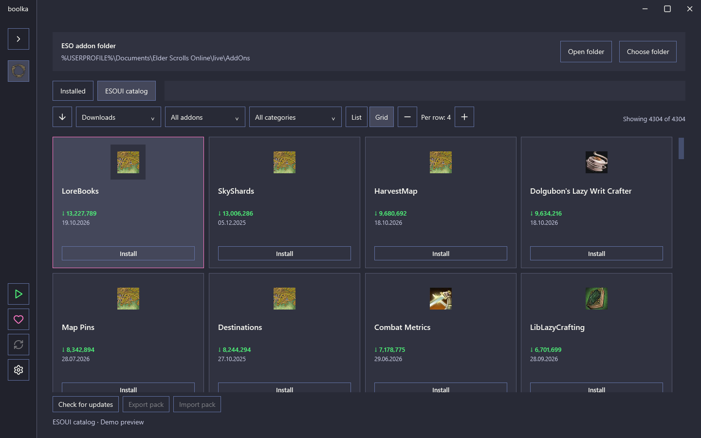
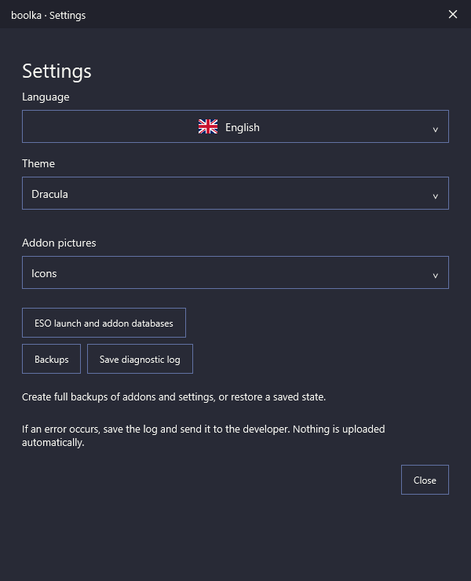

# boolka

**Менеджер аддонов The Elder Scrolls Online для Windows.**

boolka помогает находить, устанавливать и обновлять аддоны ESO, докачивать обязательные библиотеки и делиться наборами модов. Современный минималистичный интерфейс, собственная реализация — без копирования кода Minion.

*An independent Windows desktop addon manager for The Elder Scrolls Online.*

## Возможности

- Каталог ESOUI: поиск, категории, сортировка по названию, скачиваниям и дате обновления.
- Сканирование установленных аддонов, проверка обновлений и недостающих библиотек.
- Установка и обновление с резервными копиями и откатом при ошибке; успешные операции в пакете сохраняются при сбое другого аддона.
- Два вида отображения: список и плитки, регулировка масштаба и количества колонок.
- Страница аддона с описанием, изображениями и копированием текста.
- Экспорт и импорт наборов `.boolka` без отдельного сервера. Файл набора содержит список проектов, а не сами архивы модов.
- Полные резервные копии AddOns и SavedVariables с восстановлением.
- Настраиваемый запуск ESO через Steam или файл игры и программ перед запуском: готовые HarvestMap-Data/TTC, ручные пути, порядок и ожидание завершения.
- Темы Dracula, тёмная и светлая. Английский и русский интерфейсы; немецкий, французский и испанский пока в предварительной версии.
- Локальный диагностический журнал, который пользователь может сохранить и отправить вручную.

## Скриншоты

Текущий интерфейс с демонстрационными данными. Личные пути и настройки не используются.

### Каталог — список



### Каталог — плитки



### Настройки



## Запуск и сборка

Готовый GitHub-релиз пока не опубликован. Для сборки нужен Windows и [.NET 8 SDK](https://dotnet.microsoft.com/download/dotnet/8.0).

```powershell
dotnet restore src/Boolka.App/Boolka.App.csproj
dotnet build src/Boolka.App/Boolka.App.csproj -c Release --no-restore
dotnet publish src/Boolka.App/Boolka.App.csproj -c Release --self-contained false -o artifacts/boolka
```

Запускайте `artifacts/boolka/boolka.exe`, сохраняя остальные файлы папки рядом. Для этой сборки требуется .NET 8 Desktop Runtime.

При первом запуске выберите папку `Documents/Elder Scrolls Online/live/AddOns` текущего пользователя. Закройте ESO перед установкой/обновлением аддонов и восстановлением копии.

## Наборы, резервные копии и ошибки

- [Обмен наборами аддонов](PACKS.md)
- [Резервные копии и восстановление](BACKUPS.md)
- [Как сохранить диагностический журнал](DIAGNOSTICS.md)

При сообщении об ошибке укажите версию boolka и шаги воспроизведения. Перед передачей ZIP журнала просмотрите его содержимое. Приложение не отправляет отчёты автоматически.

## Текущий статус

Проект развивается и проходит тестирование. Пока поддерживается ESO на Windows. Обновление самой boolka через GitHub ещё не подключено. Перед публичным распространением необходимо завершить проверку прав на сторонние игровые изображения — см. уведомления ниже.

Клиенты TTC и HarvestMap-Data — отдельные программы авторов модов. Их наличие, сетевое обновление и последующая работа не гарантируются boolka. Если ESO запускается через boolka, отключите собственный запуск игры в TTC: **Setting → Auto Start Options → None**.

## Лицензия

Оригинальный код и документация — **PolyForm Noncommercial License 1.0.0**.

Required Notice: Copyright (c) 2026 Xlebka.

Разрешены цели, предусмотренные полным текстом лицензии. Коммерческие цели вне её разрешений требуют отдельного разрешения правообладателя. Это source-available проект с ограничением коммерческого использования.

- [Полный текст лицензии](LICENSE)
- [Сторонние материалы и их лицензии](THIRD_PARTY_NOTICES.txt)
- [Происхождение изображений](IMAGE_SOURCES.md)

Лицензия boolka не заменяет лицензии Lucide/Feather, flag-icons и права владельцев игровых материалов. boolka не является официальным продуктом ZeniMax/Bethesda и не связана с Minion или ESOUI.

## Поддержать разработку

[Boosty — Xlebka](https://boosty.to/xlebka/donate)
