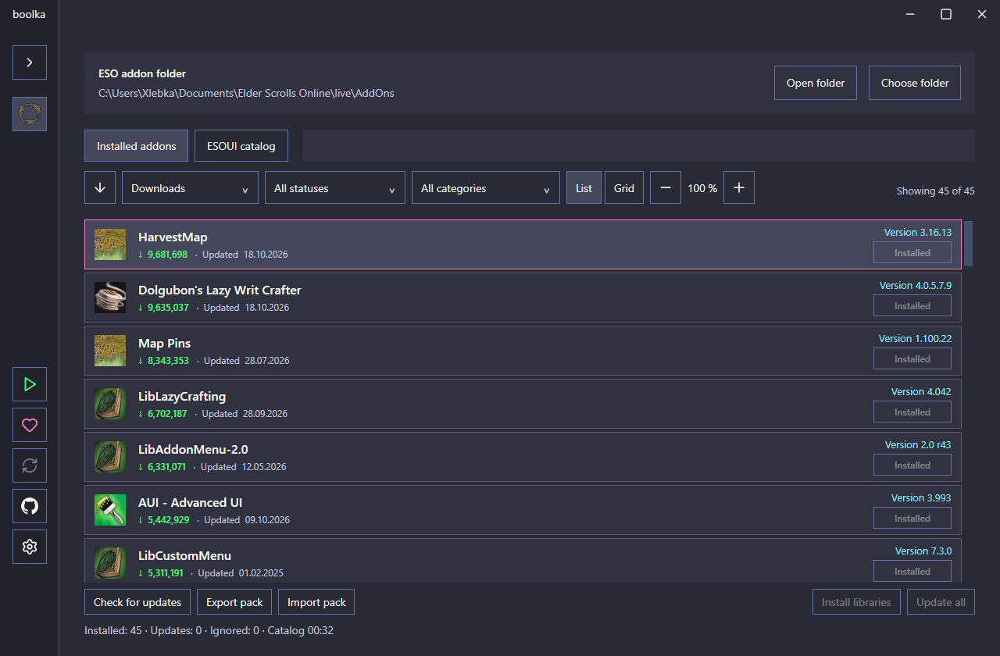
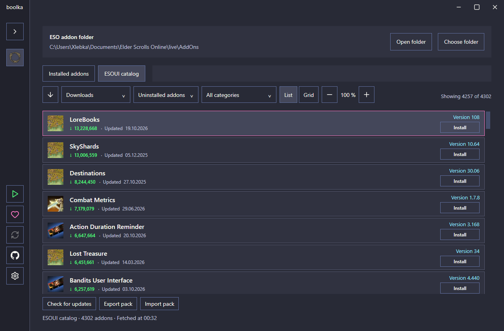
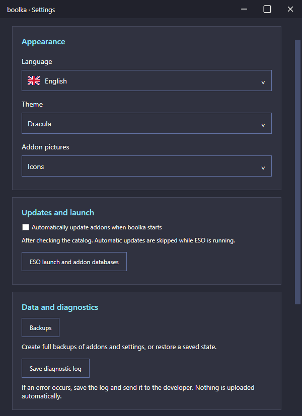
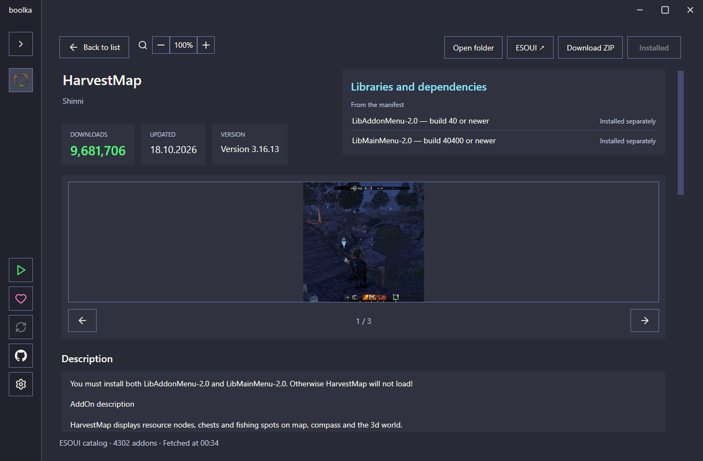

# boolka

**Менеджер аддонов The Elder Scrolls Online.**

Текущая версия — **0.41.6 · Windows x64**. Автономная сборка: устанавливать .NET отдельно не нужно.

[**Скачать boolka 0.41.6**](https://github.com/Xlebka3003/boolka/releases/tag/v0.41.6) · [Все выпуски](https://github.com/Xlebka3003/boolka/releases)

boolka помогает находить, устанавливать и обновлять аддоны ESO, докачивать обязательные библиотеки и делиться наборами модов. Современный минималистичный интерфейс, собственная реализация — без копирования кода Minion.

*An independent Windows desktop addon manager for The Elder Scrolls Online.*

## Возможности

- Каталог ESOUI: поиск, категории, сортировка по названию, скачиваниям и дате обновления.
- Сканирование установленных аддонов, проверка обновлений и недостающих библиотек.
- До скачивания зависимости не угадываются по каталогу: отображается сообщение о проверке при установке. После проверки ZIP показываются требования манифестов; у установленных модов — локальные данные. Проверенные сведения кэшируются только для той же версии и контрольной суммы.
- Перед установкой манифесты скачанных архивов определяют обязательные зависимости, включая транзитивные. Удалённые автором требования каталога не добавляются. Упоминания только в описании пока не разбираются.
- Установка и обновление с резервными копиями и откатом при ошибке; успешные операции в пакете сохраняются при сбое другого аддона.
- Автообновление аддонов при запуске: включается в настройках, по умолчанию выключено. Выполняется после проверки каталога; при запущенной ESO пропускается, игнорируемые обновления сохраняют свой статус.
- Два вида отображения: список и плитки, регулировка масштаба и количества колонок.
- Страница аддона с описанием, изображениями и копированием текста.
- Экспорт и импорт наборов `.boolka` без отдельного сервера. Файл набора содержит список проектов, а не сами архивы модов.
- Полные резервные копии AddOns и SavedVariables с восстановлением.
- Настраиваемый запуск ESO через Steam или файл игры и программ перед запуском: готовые HarvestMap-Data/TTC, ручные пути, порядок и ожидание завершения.
- Темы Dracula, тёмная и светлая. Девять языков интерфейса: английский, русский, немецкий, французский, испанский, португальский (Бразилия), польский, упрощённый китайский и японский. Названия категорий также переведены.
- Ошибки показываются на выбранном языке; технические подробности и код сохраняются в диагностическом журнале.
- Локальный диагностический журнал, который пользователь может сохранить и отправить вручную.

## Скриншоты

Скриншоты интерфейса boolka, предоставленные автором проекта.

### Установленные аддоны



### Каталог ESOUI



### Настройки



### Карточка аддона



## Установка

1. Скачайте `boolka-0.41.6-windows-x64-standalone.zip` со страницы выпуска.
2. Распакуйте весь архив в отдельную папку. Сохраните файлы лицензий рядом с приложением.
3. Запустите `boolka.exe` и выберите папку ESO AddOns.

Для обновления boolka закройте старую версию и распакуйте новый выпуск в отдельную папку. Настройки хранятся отдельно от EXE. Автоматическое обновление самой boolka пока не подключено.

## Запуск и сборка

Для сборки исходников нужны Windows и [.NET 8 SDK](https://dotnet.microsoft.com/download/dotnet/8.0).

```powershell
dotnet restore src/Boolka.App/Boolka.App.csproj
dotnet build src/Boolka.App/Boolka.App.csproj -c Release --no-restore -m:1
dotnet publish src/Boolka.App/Boolka.App.csproj -p:PublishProfile=WindowsStandalone -o artifacts/boolka-standalone -m:1
```

Запускайте `artifacts/boolka-standalone/boolka.exe`. Автономная сборка содержит .NET Desktop Runtime внутри EXE и не требует его отдельной установки. Рядом сохраняются тексты лицензий. Распаковка встроенных нативных компонентов при запуске выполняется автоматически в пользовательский временный каталог.

При первом запуске выберите папку `Documents/Elder Scrolls Online/live/AddOns` текущего пользователя. Закройте ESO перед установкой/обновлением аддонов и восстановлением копии.

## Наборы, резервные копии и ошибки

- [Обмен наборами аддонов](PACKS.md)
- [Резервные копии и восстановление](BACKUPS.md)
- [Как сохранить диагностический журнал](DIAGNOSTICS.md)

При сообщении об ошибке укажите версию boolka и шаги воспроизведения. Перед передачей ZIP журнала просмотрите его содержимое. Приложение не отправляет отчёты автоматически.

## Текущий статус

Поддерживается The Elder Scrolls Online на Windows x64. Проект развивается; сообщения об ошибках и предложения можно оставлять в Issues репозитория. Обновление самой boolka через GitHub пока не подключено. Сторонние изображения и их происхождение описаны в уведомлениях ниже.

Клиенты TTC и HarvestMap-Data — отдельные программы авторов модов. Их наличие, сетевое обновление и последующая работа не гарантируются boolka. Если ESO запускается через boolka, отключите собственный запуск игры в TTC: **Setting → Auto Start Options → None**.

## Лицензия

Оригинальный код и документация — **PolyForm Noncommercial License 1.0.0**.

Required Notice: Copyright (c) 2026 Xlebka.

Разрешены цели, предусмотренные полным текстом лицензии. Коммерческие цели вне её разрешений требуют отдельного разрешения правообладателя. Это source-available проект с ограничением коммерческого использования.

- [Полный текст лицензии](LICENSE)
- [Сторонние материалы и их лицензии](THIRD_PARTY_NOTICES.txt)
- [Происхождение изображений](IMAGE_SOURCES.md)

Лицензия boolka не заменяет лицензии Lucide/Feather, flag-icons и права владельцев игровых материалов. boolka не является официальным продуктом ZeniMax/Bethesda и не связана с Minion или ESOUI.

## Поддержать разработку

[Boosty — Xlebka](https://boosty.to/xlebka/donate)
